# Opus Operandi: possession that survives the missing ball

**More than a Hack 2027, phase 1: frame-level ball possession, FC Barcelona vs Athletic Club**

Team **Opus Operandi**: Alejandro Coves Bolaños, Jesús Sánchez Briñas, Lucas Borges de Castro, Lorena Almoguera Romero, Ismael Mohamed Mohamed.
Code: <https://github.com/Opus-Operandi-FC-Barcelona/mtah2027-possession-engine>.
Other-match benchmarks: `mtah2027-external-benchmarks`.  Full lab notebook with every experiment: `docs/TECHNICAL_REPORT.md`.

> **At a glance**
>
> * A deterministic engine labels all **199,319 frames**. Football logic does the segmentation: a possession changes hands only at a touch, and a restart starts where the tracking shows the ball leaving rest. Learned models supply the evidence.
> * Two calibrated LightGBM **specialists** (ball visible / ball hidden) and a **non-causal TCN** (±20 s of context) are trained only on **other matches**: 7 Bundesliga (IDSSE/DFL) and 20 World Cup 2022 (PFF). Labels come from algorithms, never from hand annotation.
> * Key finding: in BAR-ATH **the ball goes missing mostly while it is dead**. A label-free estimator puts this at ≥ 80 % of hidden-ball frames, against 41 % if gaps were random. Training in that estimated world was our largest data-side gain.
> * **31 ideas** were built and measured under one preregistered rule (≥ +0.010 spellF1, no seed below -0.003). **5 were adopted**; the other 26 stay in the code, off by configuration.
> * External validation (official metric): spellF1 **0.739** on IDSSE leave-one-match-out and **0.680** (macroF1 0.902) on **8 PFF matches never used for anything**. Public window: spellF1 **0.700** (macroF1 0.898), against 0.424 for the best baseline. The CSV is **byte-for-byte reproducible**, and the SHA256 is checked on Windows and Linux CI.

## 1. The task, and why it is hard

Each frame of the tactical video gets `H` (Barcelona in possession), `A` (Athletic in possession), `D` (ball dead) or
`X` (not graded).  The ranking metric treats every possession, a maximal run of `H` or `A`, as one object.  Predicted
and true possessions of the same team are matched one-to-one by temporal IoU, and F1 is averaged over five thresholds:

$$\mathrm{spellF1} = \frac{1}{5}\sum_{\theta\in\{0.3,\,0.4,\,0.5,\,0.6,\,0.7\}} \frac{2\,TP_\theta}{2\,TP_\theta+FP_\theta+FN_\theta}$$

macroF1 over `H`, `A`, `D` breaks ties.  Three consequences drove every design choice:

* **Segmentation beats frame accuracy.**  A one-second flicker invents a possession and can split a true one.  A
  per-frame classifier with 90 % accuracy can still score badly.
* **A `D` splits a possession**, so finding stoppages matters as much as the team call.
* **Boundaries must be within a few frames.**  A one-frame offset is free; a one-second offset costs about 0.35.

And the data fights back.  The tracking is automatic and uncorrected: slots are tracklets, not players.  The ball is
untracked on about 41 % of graded frames, in long blocks.  On average 20.5 players are tracked, and 14.2 % of frames
have fewer than 20.  The public window, with the ball present most of the time and 17 possessions, is far easier
than the rest of the match.  One possession moves its spellF1 by about 0.06, so we never used it to choose anything.

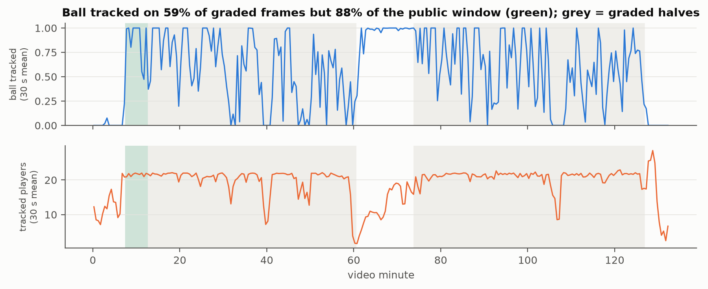

*Figure 1. Share of frames with a tracked ball (top) and tracked players (bottom), 30 s means over the whole video.
Grey: graded halves.  Green: the public window.*

## 2. Results

### 2.1 External validation: the numbers we trust

Every decision was taken on other matches, scored with the official `possession_metrics.py`:

* **B'(33):** primary criterion.  The 7 IDSSE matches, leave-one-match-out (the held-out match is an unlabelled
  target), degraded with the calibrated degrader in the estimated "gaps over dead ball" world, evaluation seeds 0-2.
* **B'(1):** guard.  The same matches with gaps placed at random.
* **A:** guard.  20 PFF matches with real occlusions (the ball missing in about a third of the frames).
* **Unseen PFF:** independent check.  8 further PFF matches (`pff_3852`-`pff_3859`) that never entered training or
  selection.

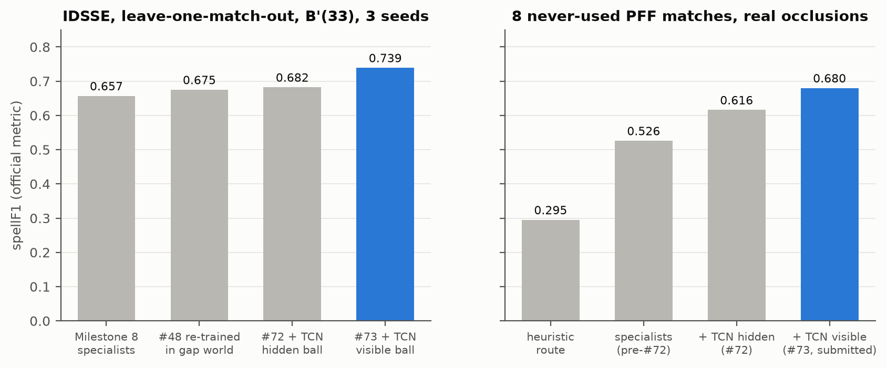

*Figure 2. Each adopted step, on the primary criterion (left) and on the 8 never-used PFF matches (right).  The
ordering is identical on both, so the gains are not an artefact of the tuning matches.*

| route | IDSSE B'(33) | IDSSE B'(1) | PFF A (20) | PFF unseen (8) |
|---|---|---|---|---|
| Heuristic route (no learning) | -- | -- | -- | 0.295 |
| Specialists A/B (pre-#72) | 0.669 | 0.602 | 0.526 | 0.526 |
| + sequence TCN on hidden-ball frames (#72) | 0.682 | 0.641 | 0.600 | 0.616 |
| **+ TCN on visible frames too (#73, submitted)** | **0.739** | **0.684** | **0.660** | **0.680** |

On the unseen PFF matches the submitted route reaches macroF1 **0.902**.

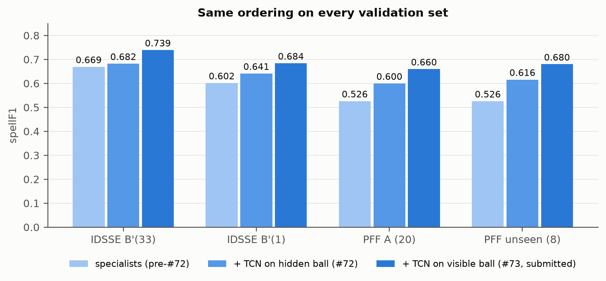

*Figure 3. The three routes on the four validation sets.*

The sequence model also finds turnovers that the specialists missed (Figure 4).  On IDSSE the H<->A turnover recall
rises from 0.570 to 0.640 with the ball visible, and from 0.357 to 0.380 with the ball hidden.  Spurious turnovers
drop from 2742 to 2477.

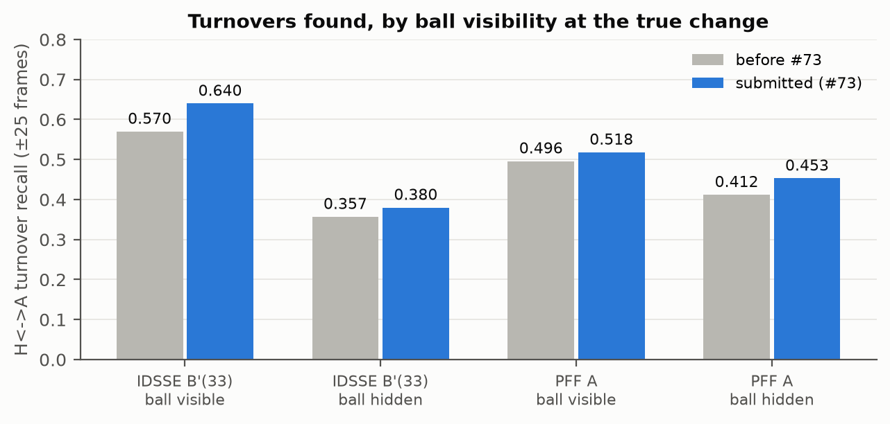

*Figure 4. True H<->A changes matched by a predicted change of the same direction within ±25 frames.*

### 2.2 Public window (official scorer, pipeline check only)

```
submission            spellF1  macroF1  possessions  mean dur  latency
Opus Operandi          0.7000   0.8978           15    16.7 s   +2.8 fr   (truth: 17 possessions, 14.2 s)
baseline_smooth125     0.4242   0.5812           16    18.5 s
baseline_smooth50      0.3256   0.6207           26    10.8 s
baseline_smooth25      0.2868   0.6200           36     7.6 s
baseline_raw           0.0378   0.5972          131     2.0 s
```

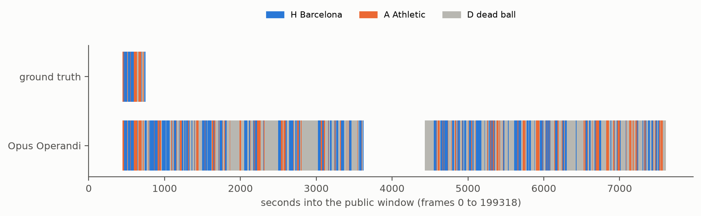

*Figure 5. Public window: ground truth (top) and our submission (bottom).*

### 2.3 The full match

Label-free aggregates of the submission (no ground truth involved and never a selection criterion):

| | submission | reference |
|---|---|---|
| Possessions | 263 | -- |
| Mean possession | 12.9 s | 14.2 s in the public truth |
| `D` share of graded play frames | 45.5 % | 29-52 % in the external matches |
| Barcelona share of alive frames | 62.6 % | -- |
| Blindness test (first 20 min with the ball hidden artificially) | spellF1 0.751 | KPI alarm at 0.75 |
| Runtime, full match, laptop CPU | under one minute | |

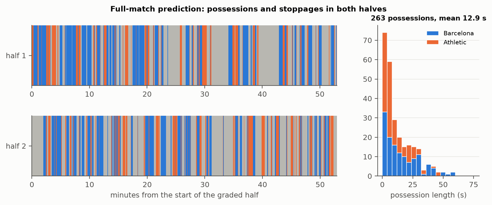

*Figure 6. Full-match prediction, both halves, and the distribution of possession lengths.*

## 3. Method overview

The engine follows the metric.  Football rules decide **where** a possession may change; learned models decide
**which** label the evidence supports; a decoder finds the single most coherent sequence.

The starting observation, on the external matches: possession in the ground truth is **event-like**.  On alive frames
the team of the last player to touch the ball matches the labelled possession about 92 % of the time; the team of the
player nearest the ball (the baseline's rule) matches it about 78 % of the time.  About 99 % of labelled turnovers
happen within 10 frames of a detected touch.  The whole engine is built on touches.

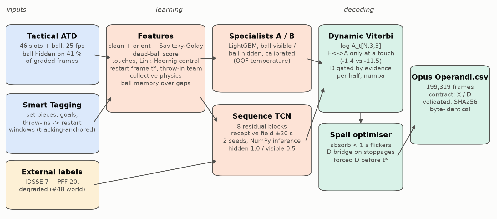

*Figure 7. End-to-end pipeline.  Blue: challenge inputs.  Yellow: external labelled data.  Orange: learning.
Green: decoding and output.*

| stage | what it does | why |
|---|---|---|
| Ingest and clean | parses every channel declared in `atd.xml`, drops staff and duplicate tracks (< 0.6 m), interpolates gaps ≤ 5 frames, Savitzky-Golay kinematics, home team always attacks +x | a clean, symmetric representation |
| Dead-ball evidence | ball beyond the lines, ball at rest, players walking, set-piece geometry | stoppages split possessions |
| Restart anchoring | the restart frame `t*` of every tagged set piece is found in the tracking, never taken from the tag window | the tags open about 3.5 s early |
| Touches and control | ball-acceleration and turning peaks near a player; Link-Hoernig control weights | turnovers happen at touches |
| Specialists A/B | calibrated LightGBM, ball visible / ball hidden | the team can be read from collective movement when the ball is gone |
| Sequence TCN | ±20 s of non-causal context over the specialists' features | long gaps need context from both sides |
| Dynamic Viterbi | time-dependent transitions `log A_t[N,3,3]` | possession changes only where football allows it |
| Spell optimiser and contract | absorbs flickers, bridges stoppages, writes the 199,319-row file | spellF1 punishes micro-possessions |

## 4. How it works

### 4.1 Reading the match

The tactical ATD holds 46 slots and the ball per frame.  The video frame is ATD `frame_id - 1`.  Coordinates are
converted to metres on the 105.3 × 68.0 m pitch, and each half is mirrored so that Barcelona always attacks +x.
Off-pitch staff and duplicate tracklets of the same team closer than 0.6 m are removed.  Gaps of up to 5 frames are
interpolated.  Velocity and acceleration come from a Savitzky-Golay filter (window 7, order 2).

### 4.2 Dead ball and restarts

A continuous dead-ball score combines four cues: ball beyond the lines, time at rest (< 0.4 m/s), mean and 80th
percentile of the players' speed (which catches stoppages even while the ball is tracked), and kick-off, goal-kick
and corner geometry.  Smart Tagging windows are used as **search windows only**.  Inside each one the restart frame
`t*` is where the ball goes from rest (< 1 m/s) to a kick (> 4 m/s), or where collective speed jumps.  Frames before
`t*` are `D`, as is the interval between a goal and the next kick-off.  Throw-ins tagged `Team = N/A` are resolved from
the tracking: the isolated player within 1.5 m of the touchline, confirmed by the first controller.  The four defending
codes in Smart Tagging name the defending team, so their possession is credited to the opponent.

### 4.3 Learning from other matches, in BAR-ATH's world

| source | matches | labels (all derived by algorithm) | role |
|---|---|---|---|
| IDSSE / DFL Sportec open data | 7 Bundesliga, 25 fps | DFL ball-status and possession channels: dead gives `D`, alive gives the possession team | training, all tuning, primary validation |
| PFF FC World Cup 2022 | 64 converted: 20 train, 8 unseen | events replayed (`OTB` owner, `OUT` dead, set-piece restarts) | training at weight 0.5, guard, independent check |
| Metrica sample data, Games 1-3 | 3 | control events give possession, stoppages give `D` | evaluation only (their ball channel vanishes when the ball is dead, which would leak `D`) |
| SkillCorner open data | 20 | `phases_of_play` | tried for training, dropped (-0.03) |

For IDSSE the labels mirror how the competition builds its own ground truth from tracking channels.  Each clean match
is **degraded** before features are computed (Figure 8): the ball is hidden in contiguous blocks with the gap-length
distribution of BAR-ATH, tracked-player counts match BAR-ATH, and the degrader adds correlated noise, identity cuts,
and duplicate and dropped tracks.  The calibration uses only label-free aggregates of the provided tracking.  Every
match is also used with home and away swapped, so no model ever sees a team identity.

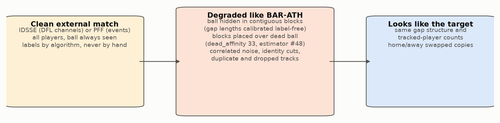

*Figure 8. Every external match is made to look like BAR-ATH before training.*

**Where the ball goes missing (Issue #48).**  If gaps were placed at random, 41 % of hidden-ball frames would be dead.
We built a label-free estimator: ball-free player features, a classifier trained on other matches, and prior-shift EM
per tracked-player stratum.  It was validated on IDSSE with planted affinities and on PFF and Metrica.  On BAR-ATH it
finds that **at least about 80 %** of hidden-ball graded frames are dead.  The tracker loses the ball mostly during
stoppages: replays, close-ups, the ball out of play.  The degrader now places gaps over dead ball with that affinity
(`dead_affinity` 33, realised odds ratio 12-19), and the models are trained in that world.

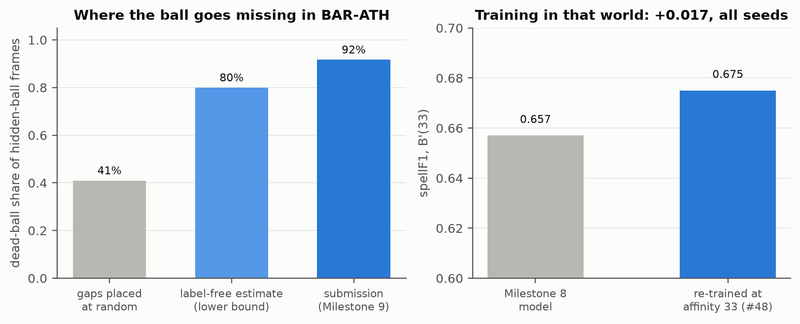

*Figure 9. Left: dead share of hidden-ball frames under three views.  Right: training in the estimated world, +0.017
on the primary criterion with every seed positive.*

### 4.4 Specialists A and B

The per-frame features cover:
* distances to the three nearest players of each team and their difference;
* Link-Hoernig control weights and a touch score;
* dynamic goalkeepers, spectral and convex-hull team areas (numba monotone chain) and their 2 s derivatives;
* velocity coherence, `R = |mean(v_i / |v_i|)|`, and line advance;
* ball memory: last and next seen position and possessor, and time since and until the ball was seen.

**Specialist A** (ball visible) and **Specialist B** (ball hidden: collective physics, coherence, memory, dead-ball
cues, a soft Smart Tagging prior) are LightGBM classifiers.  They run with `deterministic=True`, one thread and seed 0,
and are calibrated by out-of-fold temperature on whole held-out matches.  They are fused per frame by ball visibility
into `log p[N, 3]`, rounded to 1e-6.  On other matches with the ball hidden, Specialist B finds the right team on 0.85
of alive frames, against 0.62 for "last touch".

### 4.5 Sequence model (Issues #72-#73)

A non-causal dilated TCN reads the specialists' feature matrix:
* 8 residual blocks, dilations 1 to 128, 64 channels, receptive field about ±20 s, 0.2 M parameters;
* an H/A/D head and a turnover head;
* trained on degraded IDSSE (both worlds) and PFF matches 20-55, which are never in an evaluation cell;
* two training seeds, averaged.

The weights are exported to `.npz` and run in **NumPy** (parity with PyTorch to 1e-6), so the submission needs no
PyTorch.  The TCN is mixed into the emissions in log space:

$$\log p_t = (1-w_t)\,\log p^{\mathrm{spec}}_t + w_t\, s\, \log p^{\mathrm{TCN}}_t$$

with `w_t` = 1.0 on hidden-ball frames, 0.5 on visible-ball frames, and scale `s` = 0.8.

The visible-ball weight and the scale were chosen from a **preregistered grid of five** (Figure 10), posted before any
score was seen.  The winner beats the reference by +0.057 on the primary criterion, and every seed and both guards
improve.

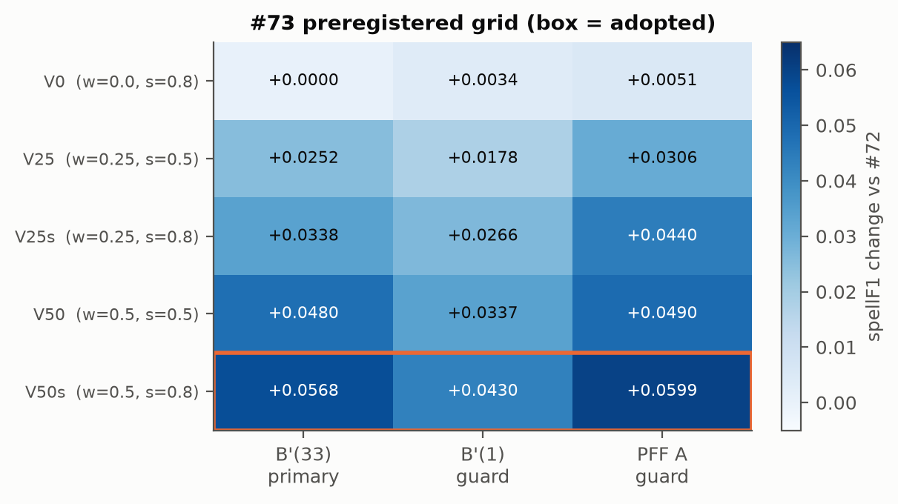

*Figure 10. #73 grid: spellF1 change against the #72 reference on the primary criterion and both guards.*

### 4.6 Decoding for the metric

Each graded half is decoded on its own by a Viterbi with **time-dependent** transitions (Figure 11):

$$\hat y = \mathrm{arg\,max}_{y_{1:T}} \sum_t \left[\log p_t(y_t) + \log A_t(y_{t-1}, y_t)\right]$$

* `log A_t(H, A)` is -11.5 at rest and opens to -1.4 within ±5 frames of a touch by the gaining team (or, moderately,
  inside a long ball gap).
* `H/A -> D` opens with dead-ball evidence.  `D -> team` stays closed until the evidence drops or a restart frame
  `t*` is reached.
* The kernel is compiled with numba and has a bit-identical NumPy fallback; the decode takes under 0.2 s.

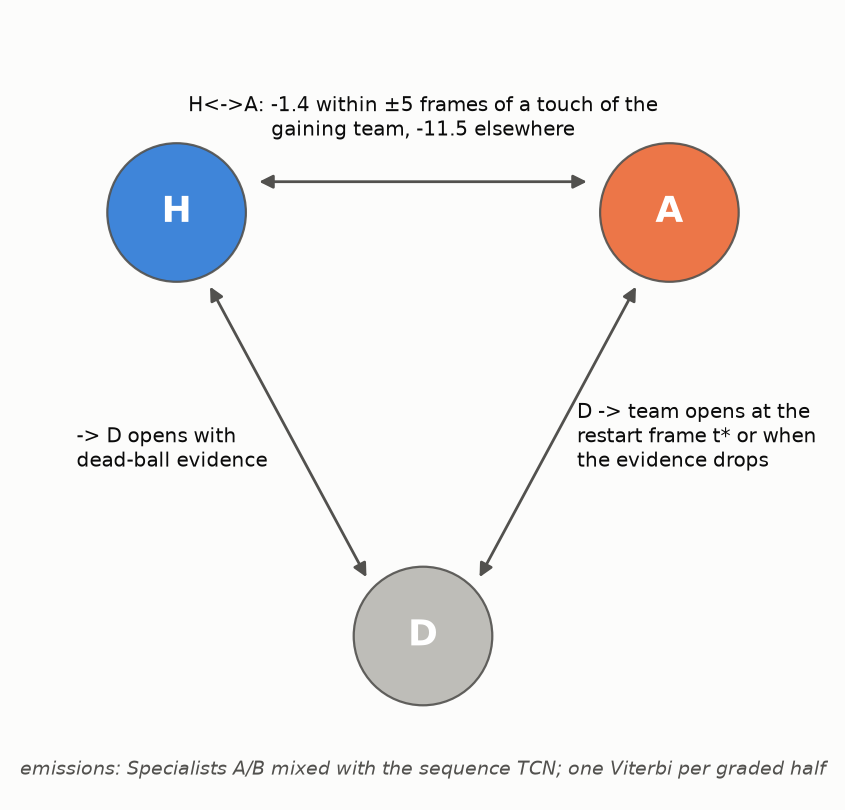

*Figure 11. Decoder states and when each transition opens.*

A **spell optimiser** then cleans the result:
* it absorbs H->A->H micro-possessions shorter than about 1 s (0.98 s, tuned on other matches), unless the ball is
  visible and shows a double touch;
* it bridges long possessions with a `D` over ≥ 4 s dead-evidence valleys that coincide with a touchline or set piece;
* the **contract** writes `X` outside the graded blocks, `D` in the second-half pre-kick-off interval and no internal
  `X`, and validates the file with the official `validate_submission.py`.

## 5. The possession rules we implement

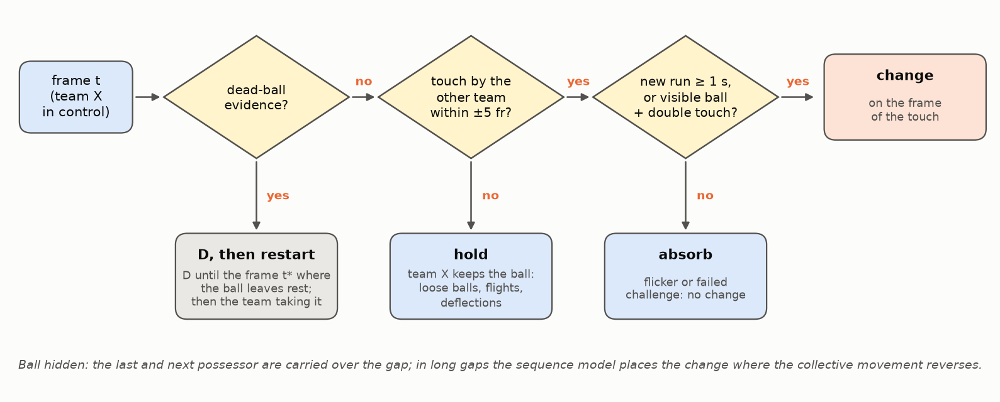

*Figure 12. From touches to possession: a failed challenge, a controlled regain, a stoppage and a restart.*

| situation | rule |
|---|---|
| **Possession** | from the touch that wins the ball until the other team's winning touch |
| **Loose balls, balls in flight** | the state is held: the last team in control keeps the ball until the other team touches it |
| **Challenges and duels** | a change needs a touch by the gaining team; simultaneous contact does not flip by itself; flickers < 1 s are absorbed unless the ball is visible with a double touch |
| **Ball out of play, fouls, goals** | `D` from the evidence of the stoppage until the restart frame `t*` found in the tracking; a `D` always splits a possession |
| **Restarts** | the team taking the restart, from the moment the ball leaves rest; unresolved throw-ins keep both `D -> H` and `D -> A` open |
| **Hidden ball** | the last and next possessor are carried over the gap with decaying confidence; in long gaps the change lands where the collective movement reverses |
| **Ungraded frames** | `X` outside the graded blocks (from `games.py`), never inside; nothing crosses a half boundary |

## 6. How we decided: one rule, 31 experiments

The public window cannot rank methods, so every idea went through the same protocol, written down before any
measurement:
* it is built in its own branch and issue, with its own tests;
* it is measured against the current default on B'(33) with evaluation seeds 0-2, with B'(1) and PFF A as guards;
* it is **adopted only if** the mean spellF1 gain is ≥ +0.010 and no seed falls below -0.003;
* otherwise the code stays, switched off by configuration.

Two correctness fixes (#50, #51) were adopted on their own merit.

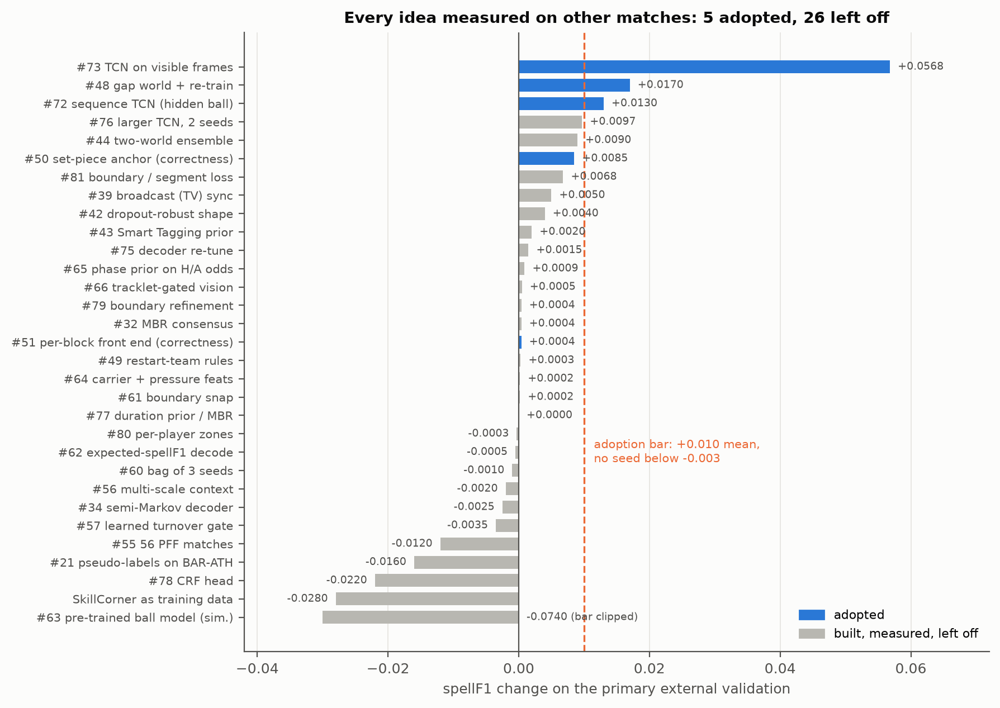

*Figure 13. Every idea and its measured effect.  Adopted ideas are blue; the dashed line is the adoption bar.*

Among the ideas left off are several that are popular elsewhere:
* a CRF head (-0.022);
* expected-spellF1 / minimum-Bayes-risk decoding (about 0);
* semi-Markov durations (-0.003);
* a larger TCN ensemble (+0.0097, just below the bar);
* pseudo-labels on BAR-ATH (-0.016);
* pre-trained and self-supervised ball detectors on the tactical video, within 0.3 m in only about 15 % of frames
  where about 0.2 m would be needed;
* broadcast synchronisation, which fills only 7.4 % of hidden tactical-ball frames (+0.005).

The video question deserves its own figure.  A ball detector on the tactical video is the obvious idea for the
41 % of frames without a ball.  We measured the ceiling on other matches by restoring the true ball in the hidden
frames (Issue #67), then degraded it the way a detector would.  A perfect ball in every gap is worth +0.046.  A
detector helps only below about 0.2 m of error and with almost no false detections.  The detectors we measured
label-free on the real tactical video (YOLO, multi-frame, pre-trained football and self-supervised models) sit at
about 1-2 m, where they would cost between 0.06 and 0.10.  So the video route stays off, by measurement rather than
by omission.

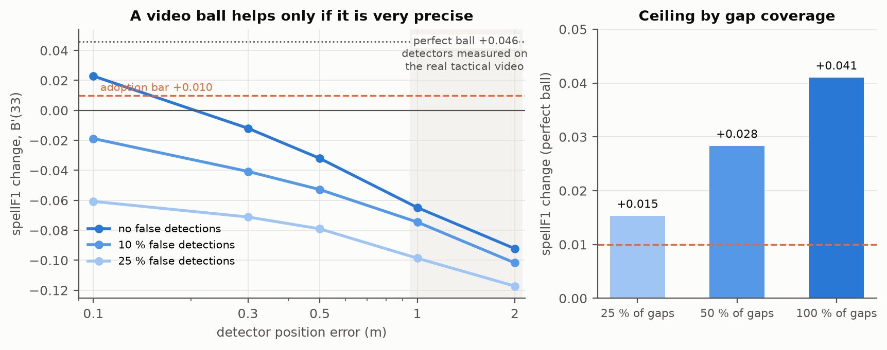

*Figure 14. What a video ball detector would have to deliver.  Left: spellF1 change on the primary criterion as a
function of the detector's position error and false-detection rate (noise rows: seed 0).  Right: ceiling with a
perfect ball, by share of gaps covered.*

We prefer a smaller, verified system to a larger one tuned on noise.

## 7. Assets used, tried and dropped

| asset | status | how |
|---|---|---|
| Tactical ATD (`x, y, s`, 46 slots, ball) and metadata XML | used | all geometry, kinematics and features; slot teams |
| Smart Tagging XML | used | set-piece and goal windows (search windows for `t*`), throw-in teams, a weak phase prior |
| Tactical homography | loaded, validity-checked | consumed only by the optional vision stages, which are off |
| Broadcast ATD + homography | tried, off | 63 % of blocks synchronised; the TV ball fills 7.4 % of hidden frames, +0.005 |
| Tactical / broadcast video | tried, off | YOLO, multi-frame, pre-trained and self-supervised detectors measured label-free on the real video; no video is processed for the submission |
| Public 5-minute ground truth | pipeline check only | alignment and format; never used to choose or tune |
| Official scorer, `games.py`, starter | used, vendored unmodified | metric, graded blocks, format check |
| IDSSE / DFL, PFF, Metrica, SkillCorner | see 4.3 | other matches only |

No private ground truth, no human-produced data about the provided game, no hand labelling and no manual correction.
Every label in the file comes out of the code in the repository.

## 8. Limitations and what we would do next

* **Missed turnovers.**  The route predicts fewer possessions than the truth: 2228 against 2759 on the 8 unseen PFF
  matches.  It misses 45 % of H<->A turnovers with the ball visible and 54 % with the ball hidden.  #79 showed that
  when a turnover is missed, the emissions carry no trace of it.  The limit is the information in the tracking, not
  the decoder.
* **Player dropout** (14.2 % of frames with fewer than 20 players) has no counterpart in the external matches.  91 %
  of those frames lie inside ball gaps, so a high `D` share there is plausible but cannot be validated externally.
* **Domain shift.**  We know BAR-ATH's noise only through label-free aggregates.  The two proxies (IDSSE and PFF)
  sometimes disagree on the size of a trade-off.  Match-to-match noise on spellF1 is about 0.04.
* **Next steps:**
  * a ball detector trained for this tactical camera (we measured that it needs about 0.2 m accuracy);
  * labelled matches in Metrica's own tracking convention;
  * a player-level set encoder in front of the TCN for the hidden-ball turnovers.

## 9. Reproduction

```bash
python -m venv .venv && source .venv/bin/activate            # Windows: .venv\Scripts\activate
pip install -r requirements.txt && pip install -e . --no-deps
# unpack the organisers' bundle into data/ (tactical/ and broadcast/), see data/README.md
python scripts/generate_submission.py --data-dir data --specialists load --team "Opus Operandi"
python evaluation/validate_submission.py "outputs/Opus Operandi.csv"
# SHA256 40f95b38fbcc942de6492a102ea74d72e180689e6f3b59c805d61edaa5116a7b
```

* **Dependencies.**  All are pinned (Python ≥ 3.10; developed on 3.13, CI on 3.11).
* **Determinism.**  `PYTHONHASHSEED=0`, fixed seeds, deterministic single-thread LightGBM, NumPy TCN inference, and
  every decoder input rounded to 1e-6.  Two runs give the same SHA256, and so do the numba and NumPy decoders.
* **Committed models.**  The submission uses only `models/specialists.json` and `models/sequence_tcn.json`.
  `scripts/train_specialists.py` and `scripts/train_sequence.py` rebuild them from the external matches.
* **CI.**  Ruff, more than 500 tests, a data-leak gate, and two full-length synthetic runs whose SHA256 must match.
* **Figures.**  `python scripts/make_figures.py` redraws every figure in this document.

## Appendix A. Training and validation data: provenance

| dataset | source and licence | who labelled it, and how | how much |
|---|---|---|---|
| IDSSE / DFL Sportec open data | Bassek et al., *Scientific Data* 12, 195, 2025 (<https://doi.org/10.1038/s41597-025-04505-y>); data <https://doi.org/10.6084/m9.figshare.28196177>, also Hugging Face `pysport/idsse-data`; CC BY 4.0 | DFL-provided ball-status and possession channels; our labels are derived mechanically from them (dead ball gives `D`, alive gives the possession team), as the competition derives its own ground truth from tracking channels | 7 Bundesliga matches at 25 fps: `J03WMX`, `J03WN1`, `J03WOH`, `J03WOY`, `J03WPY`, `J03WQQ`, `J03WR9`; training (degraded), all tuning, primary validation |
| PFF FC World Cup 2022 open data | <https://data.pff.com>, free public access under PFF's terms, accepted by the team; not redistributed | PFF event data (`OTB` ball owner, `OUT` dead ball, set-piece restarts); labels derived by replaying the events | 64 converted: the first 20 by name for the specialists (weight 0.5), matches 20-55 for the TCN, 8 never used (`pff_3852`-`pff_3859`) for the independent check |
| Metrica Sports sample data, Games 1-3 | <https://github.com/metrica-sports/sample-data>; no licence file, used locally only | Metrica events: control events give possession, stoppages give `D` | 3 matches; evaluation only |
| SkillCorner open data, A-League 2024/25 | <https://github.com/SkillCorner/opendata>, MIT | `phases_of_play` (gaps between phases give `D`) | 20 matches; tried for training, dropped |

The labelling rules are in `mtah2027-external-benchmarks/docs/LABELLING_RULES.md`.  No label, threshold or
hyper-parameter comes from the provided game, and none of the data was labelled by our team by hand.

## Appendix B. Release, fallbacks and other commands

| file | SHA256 | how |
|---|---|---|
| **submitted** (#73) | `40f95b38fbcc942de6492a102ea74d72e180689e6f3b59c805d61edaa5116a7b` | default configuration |
| fallback 1 (#72) | `a31c0a3c864fa6ce16bc39c1f3d3b51a45b9bd2abc1d2bfbbb6cc223b08b3a6a` | `sequence_model.visible_weight: 0.0`, `emission_scale: 0.5` |
| fallback 2 (pre-#72) | `cac8927c2adc1b1a6778d0045a2fae0ba4437aee8ea10a889de02db7552d0c7b` | `sequence_model.enabled: false` |

```bash
python scripts/generate_submission.py --data-dir data --specialists load --kpi        # + the KPI quality dashboard
python scripts/generate_submission.py --data-dir data --model-variant mixed            # gap (= default) | mixed | calib | idsse | pff | ensemble
python scripts/generate_submission.py --synthetic --out /tmp/sub.csv                   # self-check without the data (what CI does)
python scripts/make_figures.py                                                         # redraws docs/figures/
```

## Appendix C. Reference points on the degraded IDSSE matches

Earlier measurements, made with the first (uncalibrated) degrader:

| route | spellF1 | macroF1 |
|---|---|---|
| Official-style baseline (nearest player, majority vote) | 0.215 | 0.440 |
| Heuristic route (last toucher, dead-ball score, decoder) | 0.435 | 0.773 |
| Specialists, IDSSE only | 0.642 | 0.910 |
| Specialists (Milestone 9 model), complete ball, no degradation | 0.750 | 0.948 |

## References

1. D. Link, M. Hoernig. *Individual ball possession in soccer.* PLoS ONE 12(7), 2017.
2. M. Bassek, R. Rein, H. Weber, D. Memmert. *An integrated dataset of spatiotemporal and event data in elite soccer.* Scientific Data 12, 195, 2025.
3. S. Bai, J. Z. Kolter, V. Koltun. *An empirical evaluation of generic convolutional and recurrent networks for sequence modeling.* arXiv:1803.01271, 2018.
4. C. Lea, M. D. Flynn, R. Vidal, A. Reiter, G. D. Hager. *Temporal convolutional networks for action segmentation and detection.* CVPR 2017.
5. G. Ke et al. *LightGBM: a highly efficient gradient boosting decision tree.* NeurIPS 2017.
6. C. Guo, G. Pleiss, Y. Sun, K. Q. Weinberger. *On calibration of modern neural networks.* ICML 2017.
7. A. Viterbi. *Error bounds for convolutional codes and an asymptotically optimum decoding algorithm.* IEEE Trans. Information Theory 13(2), 1967.
8. A. Savitzky, M. J. E. Golay. *Smoothing and differentiation of data by simplified least squares procedures.* Analytical Chemistry 36(8), 1964.
9. Y. Ishikawa, S. Kasai, Y. Aoki, H. Kataoka. *Alleviating over-segmentation errors by detecting action boundaries.* WACV 2021.
10. PFF FC FIFA World Cup 2022 open data (data.pff.com); Metrica Sports sample data (github.com/metrica-sports/sample-data); SkillCorner open data (github.com/SkillCorner/opendata).
